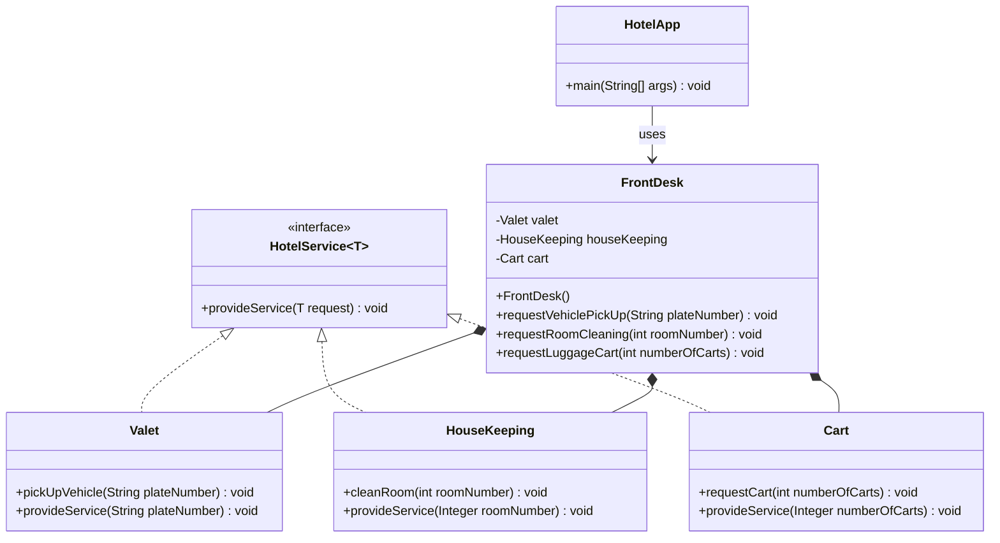

# Lab Assignment 4: Facade Pattern

## Problem Statement

### Simplified Hotel Management System

The HotelApp needs to manage various hotel services for guest check-in and check-out. These services include valet parking for vehicles, room cleaning, and handling luggage carts. However, the HotelApp aims to interact with these services through a simplified, single interface provided by the FrontDesk. The FrontDesk class should delegate the client's requests to the appropriate service classes (Valet, HouseKeeping, Cart) while abstracting the service details from the client.

## Class Definitions

- **HotelService (Interface):** Defines the common interface for all hotel services.
- **Valet:** A service class implementing the HotelService interface, responsible for vehicle valet parking and pick-up. It includes the `pickUpVehicle(plateNumber)` method.
- **HouseKeeping:** A service class implementing the HotelService interface, responsible for room cleaning. It includes the `cleanRoom(roomNumber)` method.
- **Cart:** A service class implementing the HotelService interface, responsible for handling luggage cart requests. It includes the `requestCart(numberOfCarts)` method.
- **FrontDesk:** The facade class that coordinates interactions between the client (HotelApp) and the individual hotel services.
- **HotelApp:** The client class that uses the FrontDesk facade to access and utilize hotel services seamlessly.

## UML Class Diagram



The editable PlantUML version is available in [`docs/hotel-facade.puml`](docs/hotel-facade.puml).

## Project Structure

```text
docs/
`-- hotel-facade.puml
src/
|-- HotelService.java
|-- Valet.java
|-- HouseKeeping.java
|-- Cart.java
|-- FrontDesk.java
`-- HotelApp.java
```

## How to Run

```bash
javac -d out src/*.java
java -cp out HotelApp
```

## Facade Pattern

`FrontDesk` is the facade. `HotelApp` sends simple requests to it, while the facade selects and calls the appropriate hotel service behind the scenes.
